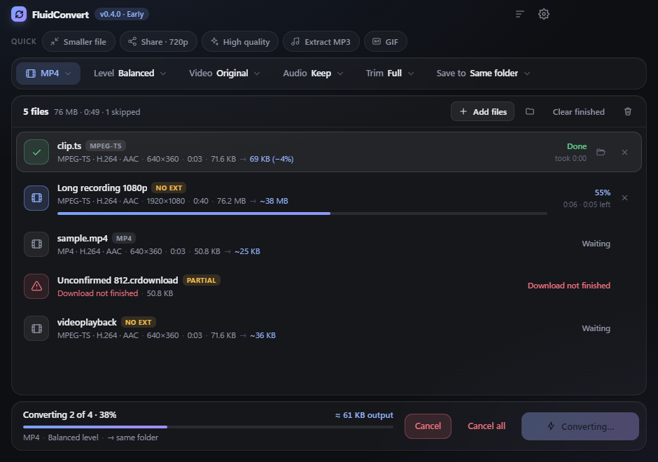

# FluidConvert

Compact, minimal Windows video converter — **batch convert**, **compress**, **trim**, and **extract audio** locally. Drop anything: even Chrome downloads with no extension or `.ts` files.

> **Early build (v0.4.0)** — functional but still early. Expect rough edges. Feedback welcome.



## Features

**Input**
- Drag & drop many files or whole folders, or browse with multi-select (`Ctrl+O`)
- Accepts **any file** — media is detected by content (ffprobe), not by extension
- Works with extensionless Chrome downloads, `.ts` / `.m2ts` / `.mts`, `.mkv`, `.webm`, `.m4v`, `.3gp`, `.flv`, `.wmv`, `.ogv`, `.mpg`, `.vob`, audio files and more
- Shows detected container and codecs per file (e.g. `MPEG-TS · H.264 · AAC`)
- Clear statuses for **Download not finished** (`.crdownload`, `.part`) and **Not a media file**

**Batch queue**
- One set of options for the whole batch; sequential conversion (or 2 at a time)
- Per-file progress, elapsed time and ETA; overall “n of N” progress
- Cancel one file, Cancel all, Clear finished, remove items, show output in folder
- Total estimated output size before you start

**Output**
- Video: **MP4, MOV, MKV, WebM, AVI, GIF**
- Extract audio: **MP3, M4A, WAV, FLAC** (MP3/M4A bitrate 320 / 192 / 128 / 96 / 64 kbps)
- **Compress level**: Low · Balanced · High · Max (higher = smaller file) · Original (stream copy) · Custom bitrate
- Resolution (Original / 1080p / 720p / 480p / custom width, never upscales) and frame rate (60 / 30 / 24)
- Audio track: keep, remove, or AAC 128k / 96k
- Trim with start/end (`hh:mm:ss` or seconds)
- Save next to the source or to a chosen folder; never overwrites (`name (1).mp4`)
- Optional **GPU encoding** (NVIDIA NVENC, Intel Quick Sync, AMD AMF) with automatic software fallback

**Design**
- Quick presets: Smaller file · Share 720p · High quality · Extract MP3 · GIF
- Compact option bar with popovers — no long settings list
- Themes: **Dark, Light, System, Midnight (OLED), Nord, Sand** + 6 accent colours
- Mac-style blended titlebar (Windows caption buttons follow the theme)
- Toast + optional Windows notification when a batch finishes
- **100% local** — no uploads, no accounts, no telemetry

### Keyboard

| Key | Action |
| --- | --- |
| `Ctrl+O` | Add files |
| `Ctrl+Shift+O` | Add folder |
| `Enter` | Convert |
| `Esc` | Close popover / settings, or cancel the running batch |
| `Delete` | Remove the selected file from the queue |
| `↑` / `↓` | Move through the queue |

## Download

Grab the latest build from [Releases](https://github.com/heeraj/FluidConvert/releases):

- `FluidConvert-Setup-0.4.0.exe` — installer
- `FluidConvert-Portable-0.4.0.exe` — portable, no install

The app is not code-signed yet, so Windows SmartScreen may warn on first launch: **More info → Run anyway** if you trust the build.

## Requirements

- Windows 10/11 x64
- For development: Node.js 18+ and npm

## Run from source

```bash
cd FluidConvert
npm install
npm start
```

## Test

```bash
npm run smoke
```

Generates small sample files (MP4, MPEG-TS, an extensionless copy, a partial download, a text file) with the bundled ffmpeg and runs them through the same probe / argument-builder / runner code the app uses.

## Build Windows installers

```bash
npm run build
```

Artifacts land in `dist/`:

- `FluidConvert-Setup-0.4.0.exe` — NSIS installer
- `FluidConvert-Portable-0.4.0.exe` — portable single EXE

ffmpeg/ffprobe are bundled via `ffmpeg-static` / `ffprobe-static`.

## Privacy

All processing happens on your machine. See [PRIVACY.md](PRIVACY.md).

## Disclaimer

Early software. You are responsible for having the rights to media you convert. See [DISCLAIMER.md](DISCLAIMER.md).

## License

MIT — Copyright © 2026 GTR / heeraj. See [LICENSE](LICENSE).
